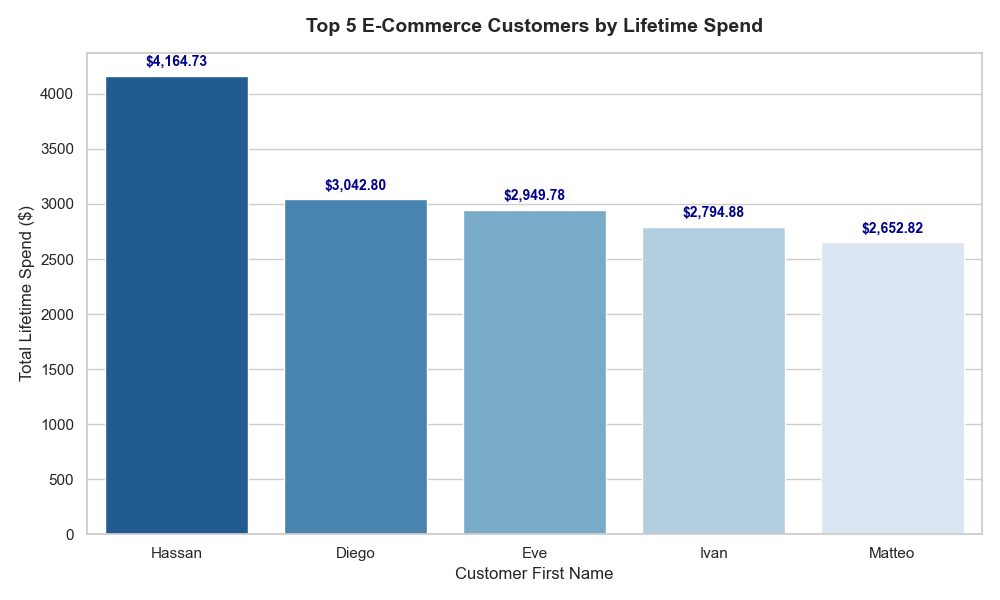

# Enterprise E-Commerce Analytics & Statistical Modeling Pipeline

A comprehensive end-to-end data engineering and analytics solution linking a SQL Server transactional database to a Python data science workflow. This project demonstrates database querying, relational data wrangling, hypothesis testing, and publication-ready data visualization.

---

## 📊 Business Situation
As digital retail platforms scale, transactional data becomes siloed across normalized relational schemas (`Customers`, `Orders`, `OrderItems`, `Payments`, `Shipments`, `Returns`). Traditional flat-file analysis falls short when tracking customer lifetime value (LTV), operational efficiency, and multi-variable attribution across large transactional volumes.

---

## 🎯 Key Objectives
* **Pipeline Infrastructure:** Establish a secure, high-performance connection between Python and a Microsoft SQL Server database (`E_CommerceDB`) using SQLAlchemy and ODBC Driver 17.
* **Relational Data Wrangling:** Merge multiple enterprise database tables in memory via Pandas, executing multi-metric aggregations to compute customer spend, order counts, and averages.
* **Statistical Hypothesis Testing:** Perform rigorous statistical evaluation using `scipy.stats` (Chi-Square test for marketing conversion lift; One-Way ANOVA for variance in order totals across order statuses).
* **Executive Data Visualization:** Generate clean, annotated visualizations using Seaborn and Matplotlib to clearly communicate actionable insights.

---

## 🛠️ Actions Taken
1. **Database Connection & DDL/DML Setup:** Built DDL/DML SQL scripts defining primary/foreign key relationships and configured a Python connection engine via `sqlalchemy` and `urllib.parse`.
2. **Pandas Aggregations:** Merged `Customers` and `Orders` datasets on `CustomerID`, grouping metrics to identify top-tier customer lifetime spend (LTV).
3. **Hypothesis Testing:**
   * **Chi-Square Test of Independence:** Evaluated campaign conversion rates, confirming a statistically significant lift ($p \approx 2 \times 10^{-13}$).
   * **One-Way ANOVA:** Tested order total variance across order statuses (`Completed`, `Pending`, `Cancelled`, `Shipped`, `Processing`), revealing statistically significant differences ($F = 3.75, p = 0.0054$).
4. **Data Visualization:** Created a programmatically annotated Seaborn bar chart displaying exact dollar values for top customers.

---

## 📈 Results & Visual Insights
* **High-Value Customer Identification:** Successfully isolated top buyers, with top spenders exceeding $4,000 in lifetime value.
* **Operational Insights:** Confirmed that order values vary significantly by order status, highlighting high-ticket orders in pending/cancelled workflows.

### Top 5 Customers by Lifetime Spend (LTV)

---

## 💻 Tech Stack & Tools
* **Database:** Microsoft SQL Server (`E_CommerceDB`)
* **Language:** Python 3.x
* **Libraries:** Pandas, SQLAlchemy, PyODBC, SciPy, Seaborn, Matplotlib
* **Version Control:** Git, GitHub